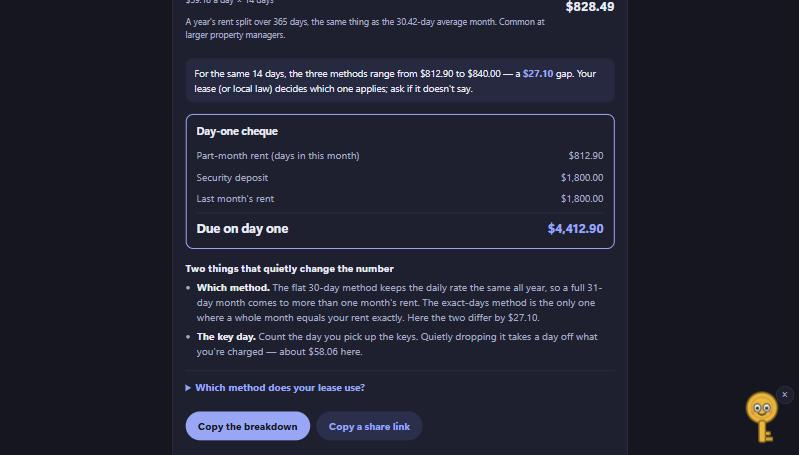

# Prorate

Moving in or out part-way through a month? Prorate works out the part-month rent three ways at once, shows the gap between them, and adds up the full cheque you write on day one. For a short let with a start and an end date, it prices the whole thing: a part-month at each end and the whole months in between.

**Use it:** https://prorate.johanthegoat.xyz



## Why

There is no single rule for proration in most places, so the same move-in date can cost different amounts depending on which method the landlord uses, and move-out is where disputes cluster ([TurboTenant](https://www.turbotenant.com/rental-lease-agreement/prorated-rent/), [Rentec Direct](https://www.rentecdirect.com/blog/calculate-prorated-rent/)). The gap is real money: for $1,800 rent and a move-in on the 18th of a 31-day month, the exact-days method gives $812.90 and the flat 30-day method gives $840.00, for the same fourteen days.

Most calculators pick one method and hand you a single number, so you can't tell whether you're being charged fairly or which method your lease actually names. Prorate shows all three side by side, flags the cheapest and dearest, and spells out the two things that quietly change the figure.

## How it works

- **Three methods, same part-month.**
  - **Days in this month:** rent split over the real length of the month (28, 29, 30 or 31). This is the only method where a whole month comes to exactly one month's rent, and the one most guides call the fairest ([RentRedi](https://rentredi.com/blog/what-is-prorated-rent-and-how-to-calculate/)).
  - **Flat 30-day month:** rent always split over 30. The daily rate never changes, which is why landlord software likes it, but in a 31-day month a full month works out to *more* than one month's rent.
  - **Daily rate (365-day year):** a year's rent split over 365 days. This is the same number as the "30.42-day average month" (365 ÷ 12 = 30.42), so Prorate shows it once rather than twice.
- **Count the key day.** Moving in, you get the keys on the move-in day, so that day counts; moving out, your last night counts. Dropping it quietly takes a day's rent off the bill, which is why it's worth being explicit. There's a switch for the case where you genuinely don't stay the last day.
- **The day-one cheque.** On move-in, landlords usually want the part-month rent plus a deposit, sometimes last month's rent, and any fees, all at once. Prorate totals the real amount you hand over on day one.
- **Rent quoted per week, per 4 weeks or per year.** Lots of lettings quote a weekly rent, and the right monthly figure is `week × 52 ÷ 12`, not `week × 4`: four weeks is only 28 days, so the ×4 shortcut undercounts a monthly rent by about 7.7%. Pick the period you were quoted and Prorate converts to a monthly rent first, showing the working (and, for a weekly rent, what the ×4 mistake would have been) before it prorates. The default is per month, so every existing result is unchanged.
- **The two traps, called out.** Which method the lease uses, and whether the key day is counted, are the two things that move the number, so the result names both.
- **Whole short lets.** Pick a move-in and a move-out date and Prorate prices the full tenancy: the part-month you pay when you arrive, every complete month at the stated rent, and the part-month when you leave, totalled all three ways. Proration only touches the two ends, because that is what leases actually do.
- **Share without uploading.** Copy the breakdown as plain text, or a link that carries your numbers in the URL fragment. Nothing is sent anywhere; the whole thing runs in the browser.

The amounts, the day count and the currency all update as you type. Currency symbol is guessed from your browser language and only affects the label.

This is general information, not legal advice. Your lease and local landlord-tenant law decide which method applies; if the lease doesn't say, it's a fair question to ask before you pay.

## Run it

Open `index.html`. No build step.

```
npm test
```

runs the engine tests on Node 20, 22 and 24 (also in CI).

MIT licence.
